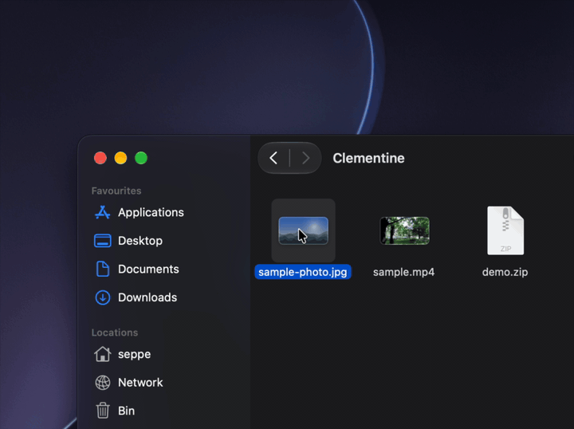

<p align="center"></p>

# Clementine

Convert files on your Mac without opening an app. Start dragging a file, tap a key, drop it on a
wheel.

Everything runs locally. Files are never uploaded, and the original is never changed: the
converted file is saved next to it.

<p align="center"></p>

## How it works

1. Drag one or more files, from Finder or anywhere else.
2. While dragging, tap a key:
   - **Shift** opens the convert wheel.
   - **Control** opens the actions wheel.
3. Drop the files on a wedge.

Dropping anywhere else is a normal drop. Conversions that take longer than a couple of seconds
show their progress in the menu bar.

## What it converts

| From | To |
|------|----|
| Images: JPG, PNG, HEIC, TIFF, GIF, BMP, WebP | JPG, PNG, HEIC, TIFF, PDF |
| Video: MP4, MOV, MKV, WebM, AVI, WMV, … | MP4, MOV, MKV, WebM, AVI, WMV, GIF |
| Audio: MP3, M4A, WAV, AIFF, FLAC, OGG, Opus, WMA, … | MP3, M4A, WAV, AIFF, FLAC, OGG, Opus, WMA |
| Archives: ZIP, 7z, RAR, TAR, TAR.GZ, TAR.BZ2, TAR.XZ | ZIP, 7z, TAR, TAR.GZ, TAR.XZ |
| Folders | ZIP, 7z, TAR.GZ, TAR.XZ |
| Word: DOCX | PDF (laid out like Word), TXT |
| Text: RTF, HTML, TXT | PDF, DOCX, RTF, HTML, TXT |
| Markdown | PDF, DOCX, HTML, TXT |
| PDF | DOCX, TXT (text only) |
| Pages (when Pages is installed) | PDF, DOCX, RTF, TXT, EPUB |

Actions:

- **Copy**, **Copy Path**, **AirDrop**, **Compress** and **Extract** for any file
- **Shrink** images (25–90%) or videos (1080p, 720p, 480p)
- **Rotate** images and MP4 or MOV videos
- **Remove Background** from images
- **Combine into PDF** for images and PDFs
- **Remove Audio** from videos, or **Extract Audio** to MP3, M4A, WAV, AIFF, FLAC, OGG, Opus or WMA

## Install

Download `Clementine-<version>.zip` from [Releases](https://github.com/seppedelanghe/Clementine/releases),
unzip it and move Clementine to Applications. It lives in the menu bar and updates itself.

Requires macOS 14 or later on Apple silicon.

## Building

Needs the Xcode Command Line Tools, `pkg-config` (`brew install pkgconf`) and
[rustup](https://rustup.rs). Xcode itself isn't needed.

```sh
make run   # builds build/Clementine.app and opens it
```

The first build also downloads and compiles the bundled ffmpeg and docxide-pdf, which takes a few
minutes.

## License

MIT, see [LICENSE](LICENSE). The bundled ffmpeg is built from source under the LGPL; see
[docs/ffmpeg.md](docs/ffmpeg.md).
